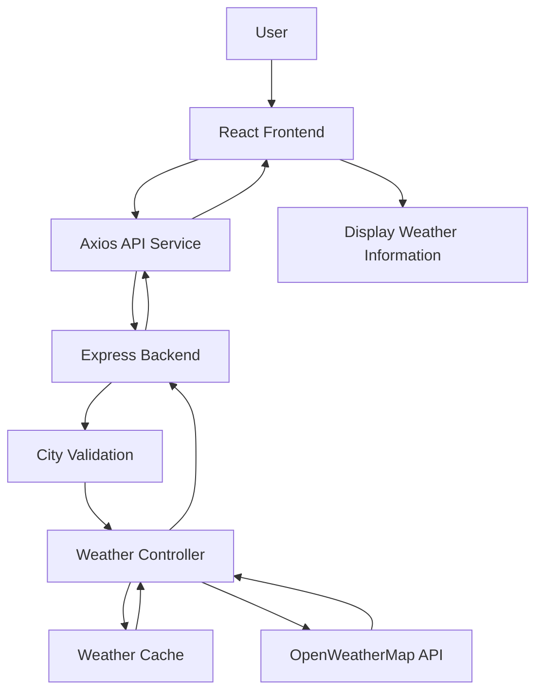

# 🌤️ Aethera — Weather Intelligence

<p align="center">
  <strong>A modern full-stack weather forecasting application</strong>
</p>

<p align="center">
  <a href="https://aethera-bay.vercel.app/">🌐 Live Application</a> •
  <a href="https://aethera-backend-yuih.onrender.com/api/health">⚙️ Backend API</a> •
  <a href="https://github.com/scarletsiren50-art/Aethera">📂 GitHub Repository</a>
</p>

---

## 🌐 Live Demo & Deployment

Aethera is deployed and accessible online.

| Component | Deployment | Link |
|---|---|---|
| Frontend | Vercel | [Open Aethera](https://aethera-bay.vercel.app/) |
| Backend | Render | [Backend API](https://aethera-backend-yuih.onrender.com/) |
| Backend Health | Render | [Check API Status](https://aethera-backend-yuih.onrender.com/api/health) |
| Source Code | GitHub | [View Repository](https://github.com/scarletsiren50-art/Aethera) |

**Try Aethera:** Visit the live application, search for a city, and explore its weather information and forecast.

---

## 📌 Project Information

| Detail | Information |
|---|---|
| Internship Organisation | CODEC Technologies India |
| Internship Role | Full Stack Developer Intern |
| Internship Task | Task 6 – Weather Forecast Application |
| Project Type | API-Driven Engineering Project |
| Development Status | Completed |
| Deployment Status | Pending |

---

## 👩‍💻 About the Developer

| Detail | Information |
|---|---|
| Name | Md. Sadiya Tabassum |
| College | IFHE, Hyderabad |
| Academic Status | Final-year B.Tech Student |
| Course | B.Tech – Data Science & Artificial Intelligence |
| Internship Organisation | CODEC Technologies India |
| Internship Designation | Full Stack Developer Intern |
| Internship Location | Pan India – Remote/Hybrid |
| Internship Duration | 27 October 2026 – 27 November 2026 |

---

## 📖 Project Overview

Aethera is a full-stack weather forecasting application developed as part of the CODEC Technologies internship.

The application retrieves real-time weather information and five-day weather forecasts using the OpenWeatherMap API.

The frontend is developed using React and Vite, while the backend uses Node.js and Express.js to handle API requests, validate city inputs, and communicate with the external weather service.

The application follows a client-server architecture, keeping API communication and configuration separate from the frontend.

## 🎯 Project Objectives

- Develop a functional full-stack weather forecasting application.
- Integrate an external weather API.
- Retrieve current weather information based on city searches.
- Provide five-day weather forecasts.
- Build a responsive and user-friendly interface.
- Implement backend API routes and input validation.
- Apply environment variables and basic backend security practices.
- Understand frontend-backend communication in a real-world application.

## ✨ Key Features

- **Current Weather:** Retrieve current weather information for a searched city.
- **Five-Day Forecast:** Display upcoming weather forecast information.
- **City Search:** Search for weather information using city names.
- **API Integration:** Fetch weather data through the OpenWeatherMap API.
- **Responsive Interface:** React-based user interface.
- **Light and Dark Themes:** Theme support within the application.
- **Weather Visualizations:** Weather-focused visual components.
- **Backend Validation:** Validate city inputs before processing requests.
- **API Error Handling:** Handle invalid routes and backend errors.
- **Caching:** Backend weather caching using NodeCache.
- **Security:** Helmet, CORS configuration, and API rate limiting.

## 🛠️ Technology Stack

### Frontend

- React 19
- Vite
- JavaScript
- CSS3
- Axios
- Lucide React

### Backend

- Node.js
- Express.js
- JavaScript
- Axios
- dotenv
- CORS
- Helmet
- express-rate-limit
- NodeCache

### External API

- OpenWeatherMap API

### Development Tools

- Visual Studio Code
- Thunder Client
- Git
- GitHub

## 🏗️ System Architecture

Aethera follows a client-server architecture.



### Architecture Components

| Component | Responsibility |
|---|---|
| React Frontend | Displays the user interface |
| Axios Service | Sends HTTP requests to the backend |
| Express Backend | Handles API requests |
| Validation Middleware | Validates city input |
| Weather Controller | Processes weather API requests |
| Weather Cache | Stores cached weather data |
| OpenWeatherMap | Provides weather information |

## 📁 Project Structure

```text
Aethera/
│
├── client/
│   ├── public/
│   ├── src/
│   │   ├── assets/
│   │   ├── components/
│   │   │   ├── SearchBar.jsx
│   │   │   ├── ThemeToggle.jsx
│   │   │   └── WeatherVisual.jsx
│   │   ├── context/
│   │   │   └── ThemeContext.jsx
│   │   ├── hooks/
│   │   ├── pages/
│   │   │   └── Dashboard.jsx
│   │   ├── services/
│   │   │   └── weatherService.js
│   │   ├── styles/
│   │   ├── App.css
│   │   ├── App.jsx
│   │   ├── index.css
│   │   └── main.jsx
│   ├── .env
│   ├── .env.example
│   ├── package.json
│   └── vite.config.js
│
├── server/
│   ├── config/
│   │   └── env.js
│   ├── controllers/
│   │   ├── healthController.js
│   │   └── weatherController.js
│   ├── middlewares/
│   │   ├── errorMiddleware.js
│   │   ├── rateLimitMiddleware.js
│   │   └── validateCity.js
│   ├── routes/
│   │   ├── healthRoutes.js
│   │   └── weatherRoutes.js
│   ├── services/
│   │   └── weatherCache.js
│   ├── .env
│   ├── .env.example
│   ├── package.json
│   └── server.js
│
├── .gitignore
├── LICENSE
└── README.md
```

## 🔗 API Documentation

The backend exposes the following endpoints.

**Base URL (local development):**

```text
http://localhost:5000/api
```

### 1. Backend Health Check

| Method | Endpoint |
|---|---|
| GET | `/api/health` |

Checks whether the backend server is running.

### 2. Current Weather

| Method | Endpoint |
|---|---|
| GET | `/api/weather/current?city=Hyderabad` |

Retrieves current weather information for the specified city.

### 3. Five-Day Weather Forecast

| Method | Endpoint |
|---|---|
| GET | `/api/weather/forecast?city=Hyderabad` |

Retrieves the five-day weather forecast for the specified city.

**Request Parameter:**

| Parameter | Type | Description |
|---|---|---|
| city | String | City name for which weather information is requested |

## ⚙️ Installation and Setup

### Prerequisites

Make sure the following are installed:

- Node.js
- npm
- Git
- Visual Studio Code
- OpenWeatherMap API key

### Step 1: Clone the Repository

```bash
git clone https://github.com/scarletsiren50-art/Aethera.git
```

```bash
cd Aethera
```

### Step 2: Install Backend Dependencies

```bash
cd server
npm install
```

### Step 3: Configure Backend Environment Variables

Create a `.env` file inside the `server` directory.

```env
PORT=5000
NODE_ENV=development
CLIENT_URL=http://localhost:5173
OPENWEATHER_API_KEY=your_openweather_api_key
```

Replace the placeholder with your actual OpenWeatherMap API key.

### Step 4: Start the Backend

```bash
npm run dev
```

The backend runs at:

```text
http://localhost:5000
```

### Step 5: Install Frontend Dependencies

Open another terminal:

```bash
cd client
npm install
```

### Step 6: Configure Frontend Environment Variables

Create a `.env` file inside the `client` directory.

```env
VITE_API_BASE_URL=http://localhost:5000/api
```

### Step 7: Start the Frontend

```bash
npm run dev
```

Open the local development URL:

```text
http://localhost:5173
```

## 🌐 Live Deployment

**Deployment Status:** Pending.

The planned deployment platforms are:

| Component | Platform |
|---|---|
| Frontend | Vercel |
| Backend | Render |
| Source Code | GitHub |

Live application URL: To be added after deployment.

## 🧪 Testing

The application can be tested using Thunder Client in Visual Studio Code.

| Test | Method | Endpoint |
|---|---|---|
| Backend Health Check | GET | `/api/health` |
| Current Weather | GET | `/api/weather/current?city=Hyderabad` |
| Weather Forecast | GET | `/api/weather/forecast?city=Hyderabad` |

Testing includes checking backend availability, weather API requests, and city-based request handling.

## 🔐 Security Considerations

- Environment variables are used to store sensitive configuration.
- The OpenWeatherMap API key is maintained on the backend.
- Helmet is used for HTTP security headers.
- CORS is configured to control frontend access.
- Express rate limiting helps restrict excessive API requests.
- City input is validated through middleware.
- Centralized error-handling middleware is configured.
- `.gitignore` excludes environment files and dependency folders from Git tracking.

## 🚀 Future Enhancements

Potential improvements include:

- Automatic location-based weather detection.
- Hourly weather forecasts.
- Weather alerts and notifications.
- Saved favourite cities.
- Air quality information.
- Interactive weather maps.
- Additional weather analytics.
- Progressive Web App support.

## 📚 Learning Outcomes

Through this project, I gained practical experience in:

- Building a full-stack application using React and Node.js.
- Integrating third-party APIs.
- Creating REST API endpoints using Express.js.
- Connecting frontend services with backend APIs using Axios.
- Implementing middleware and input validation.
- Managing environment variables.
- Applying caching and rate limiting.
- Understanding client-server architecture.
- Testing APIs using Thunder Client.
- Organizing a full-stack project for deployment.

## 👩‍💻 Author

**Md. Sadiya Tabassum**

Final-Year B.Tech Student  
Data Science & Artificial Intelligence  
IFHE, Hyderabad

Full Stack Developer Intern  
CODEC Technologies India

- GitHub: [scarletsiren50-art](https://github.com/scarletsiren50-art)
- LinkedIn: [Sadiya Tabassum](https://www.linkedin.com/in/sadiya-tabassum-aa8459339)

## 📜 Internship Project Declaration

This project, **Aethera – Weather Intelligence**, was developed as part of the Full Stack Developer Internship at CODEC Technologies India.

The application demonstrates practical implementation of frontend development, backend development, API integration, and full-stack application architecture.

## 📄 License

This project is distributed under the license included in the repository's `LICENSE` file.

---

<p align="center">
  Developed with ❤️ by Md. Sadiya Tabassum
  <br/>
  Aethera – Weather Intelligence
</p>